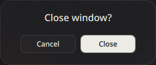

# Linux Config Notes

Personal Linux setup notes for Hyprland and Fish shell.

## Repo Contents

- `End-4/keybinds.txt`: Hyprland Lua keybind snippets.
- `End-4/confirm-close.sh`, `restore-closed.sh`, `window-close.py`, and `confirm-close.qml`: close confirmation and last-app reopening.
- `End-4/confirm-close-rules.lua`: blur and animation settings for the close dialog.
- `End-4/fish.txt`: Fish shell prompt and greeting config snippets.

## Wallpapers

All files in the `Wallpaper/` directory are maintained in `1920x1200` format.

## Cap

Super+R opens the installed [Cap](https://cap.so) desktop app using its
`Cap.desktop` launcher. The binding is synced in the live custom `keybinds.lua`,
the dots-hyprland copy, and `End-4/keybinds.txt`.

```bash
env -u ELECTRON_RUN_AS_NODE GDK_BACKEND=x11 gtk-launch Cap
hyprctl reload config-only
hyprctl configerrors
```

The Cap desktop launcher must be installed in your applications directory.
`GDK_BACKEND=x11` uses XWayland so the Cap window displays correctly on this setup.

## Close Confirmation



Super+Q opens a small charcoal dialog at 72% opacity with Close selected. Enter
closes the window immediately. Escape, Cancel, or clicking outside dismisses it.
Tab or arrow keys select a button; Enter or Space activates it. Repeated Super+Q
presses keep one dialog open. The selected window is captured before the dialog
opens, so a focus change cannot close another app.

Super+Shift+Q reopens the one most recently closed app. Only confirmed closes
through this dialog are remembered. Canceling or failing to close preserves the
previous entry; a successful reopen clears it. Native save prompts still work:
the controller waits for the requested window to actually disappear before
updating the entry.

Installed apps use their desktop launcher; AppImages use their original path.
VS Code preserves the selected project and profile when they can be identified
from its session metadata. Other window contents and unsaved state depend on the
app's own session restore. Missing or ambiguous project metadata falls back to
opening the app normally.

The runtime lock and dialog socket live under `$XDG_RUNTIME_DIR/hypr-close-*`.
The single restore entry is private and stored at
`${XDG_STATE_HOME:-~/.local/state}/hypr/window-close/last-closed.json`.

From this repository, install the four runtime files into each config copy:

```bash
install -m 755 End-4/confirm-close.sh End-4/restore-closed.sh End-4/window-close.py ~/.config/hypr/custom/scripts/
install -m 644 End-4/confirm-close.qml ~/.config/hypr/custom/scripts/
install -m 755 End-4/confirm-close.sh End-4/restore-closed.sh End-4/window-close.py ~/Desktop/dots-hyprland/dots/.config/hypr/custom/scripts/
install -m 644 End-4/confirm-close.qml ~/Desktop/dots-hyprland/dots/.config/hypr/custom/scripts/
```

Add the Super+Q and Super+Shift+Q blocks in `End-4/keybinds.txt` to each custom
`keybinds.lua`, and add `End-4/confirm-close-rules.lua` to each custom `rules.lua`.
The runtime requires Hyprland with Lua configuration, QuickShell, Python 3, and
PyGObject with GioUnix, which are present in this desktop setup.

```bash
python3 -m unittest discover -s End-4/tests
/usr/lib/qt6/bin/qmllint End-4/confirm-close.qml
hyprctl reload config-only
hyprctl configerrors
```

## Custom Sidebar

Super+A opens a compact HyprTrack summary and to-do list at the original sidebar
width. It shows today's usage, the daily average for active days in the last seven
days, and a seven-day line chart. The app arrow opens HyprTrack; summary reads do
not launch it or modify its code. Tasks share the shell's existing saved list.
The task input focuses when the drawer opens, so start typing and press Enter to
create a task. The original HyprTrack logo is kept.

Source, data definitions, installation and restore instructions are in
[End-4/sidebar/README.md](End-4/sidebar/README.md). A matching package lives in
the dotfiles repo's `dots/.config/hypr/custom/sidebar/` directory. The older
`CustomSidebar/` files describe a previous clipboard/speaking design.

## Clipboard Paste

Super+V opens the existing clipboard picker. Click an item, or select one with
Up/Down and release Enter, to close the picker and paste into the original window.
Normal apps use Ctrl+V; recognised terminal apps use Ctrl+Shift+V. The helper sends
no Enter key. The explicit Copy action still only copies.

Each history row also has a pin button. Saved items appear at the top of the same
clipboard list, followed by recent history. Use the unpin button to remove a pin.
There are no History/Pinned tabs, and the clipboard view hides Lens and music
recognition controls. Pins keep their own
text/image originals in `~/clipboard/pinned/`, so they survive history cleanup
and shell restarts. Normal history still uses cliphist's existing database.

The **Clear history** button at the top asks for confirmation before clearing the
entire normal history, regardless of the search filter. Saved pins are kept.
Cancel is focused by default, and Escape dismisses the confirmation.

The helper checks the original window's address, process ID and stable ID before
restoring focus. If that window closes or focus changes before pasting, it leaves
the item copied and shows a notification.

Source, reinstall instructions, terminal support and backup/restore commands are
in [End-4/clipboard/README.md](End-4/clipboard/README.md). The matching package is
kept in `dots/.config/hypr/custom/clipboard/` in the dots-hyprland repository.

## Update End-4 Dots

Keep `~/.config/hypr/custom`. Back up the working configuration before updating:

```bash
python3 End-4/clipboard/customizations.py backup
```

The command prints a private snapshot directory under
`~/.local/state/hypr-customization-backups/`. Keep that exact path for rollback.
It includes Hyprland, QuickShell and illogical-impulse settings; treat it as
private because desktop settings can contain credentials.

Review and save your intended source changes before merging upstream. Keep
`local-docs/` and real environment files out of commits. In the dotfiles repository:

```bash
cd ~/Desktop/dots-hyprland
git status --short
git fetch upstream
git diff --stat HEAD upstream/main
git merge upstream/main
```

Stop if Git reports conflicts. Once the source is merged, check the clipboard
and sidebar integrations against it before replacing the running configuration:

```bash
python3 ~/Desktop/code/Linux/End-4/clipboard/customizations.py check --config-root ~/Desktop/dots-hyprland/dots/.config
python3 ~/Desktop/code/Linux/End-4/sidebar/customizations.py check --config-root ~/Desktop/dots-hyprland/dots/.config
```

If compatible, review the updated `setup` script and use `./setup install`
(the old `./install.sh` command was renamed). Preserve existing custom files when
the installer asks. Keep a terminal open during the update. Afterwards, check and
reapply both integrations:

```bash
python3 ~/Desktop/code/Linux/End-4/clipboard/customizations.py check
python3 ~/Desktop/code/Linux/End-4/sidebar/customizations.py check
python3 ~/Desktop/code/Linux/End-4/clipboard/customizations.py install
python3 ~/Desktop/code/Linux/End-4/sidebar/customizations.py install
hyprctl reload config-only
hyprctl configerrors
```

The integration installer checks supported source file versions before writing
anything, takes another backup, and rolls back its own edits on a write failure.
If the compatibility check fails, adapt the integration to the new upstream code
before applying it. Do not force old QuickShell files over new ones. Confirm the
existing custom bindings and clipboard behaviour still work after reload.

If the update breaks the desktop, restore the saved working snapshot from a
terminal or TTY, using the exact directory printed by the backup command:

```bash
python3 ~/Desktop/code/Linux/End-4/clipboard/customizations.py restore --backup /absolute/path/to/saved-snapshot
hyprctl reload config-only
hyprctl configerrors
```

Restore keeps a backup of the configuration it replaces. It restores the saved
desktop configuration, not installed package versions or Git history. If a package
upgrade changed Hyprland/QuickShell APIs, the matching package version may also be
needed. See the clipboard README for reloading QuickShell and a fresh install.

## Quick Edit Paths

```bash
nvim ~/.config/hypr/custom/keybinds.lua
nvim ~/.config/hypr/custom/scripts/confirm-close.qml
nvim ~/.config/hypr/custom/scripts/window-close.py
nvim ~/.config/fish/config.fish
chmod +x ~/.config/hypr/custom/scripts/confirm-close.sh
```
